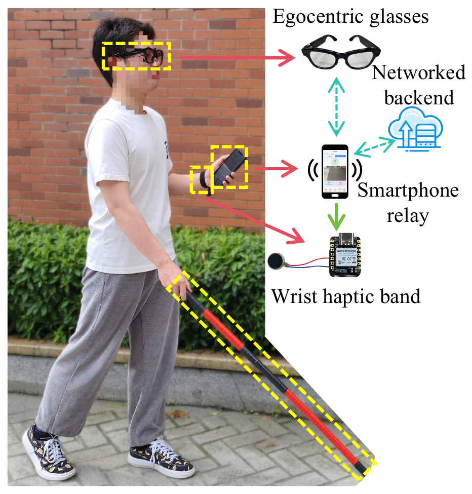
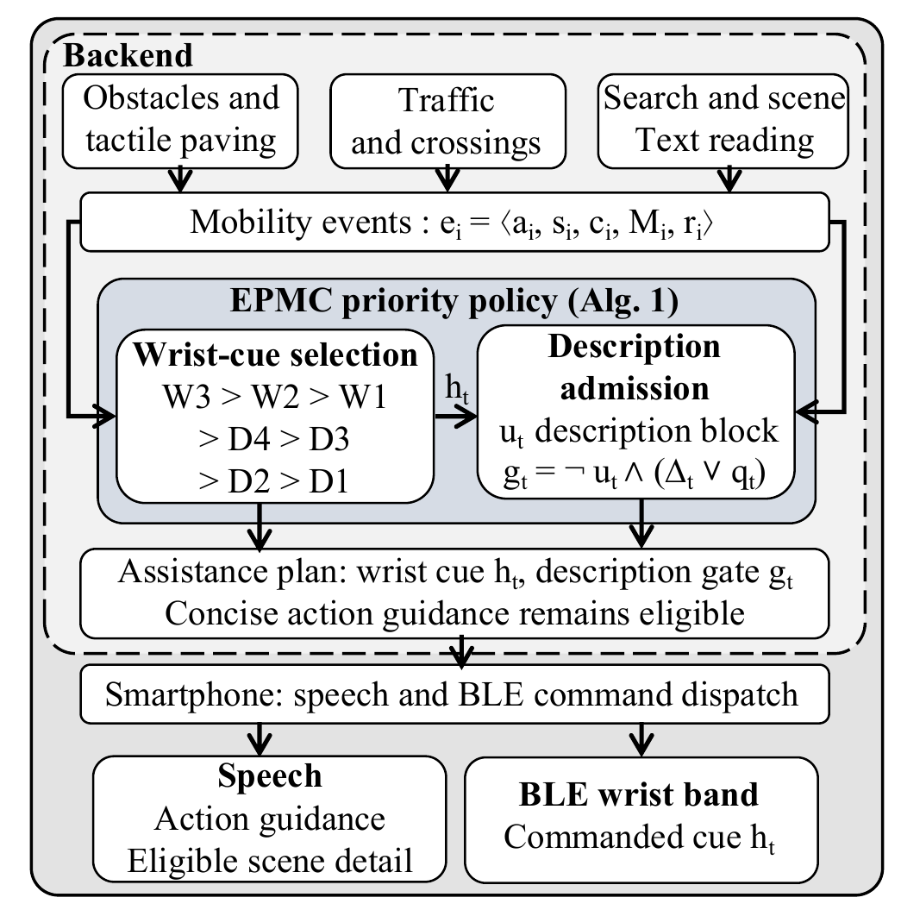
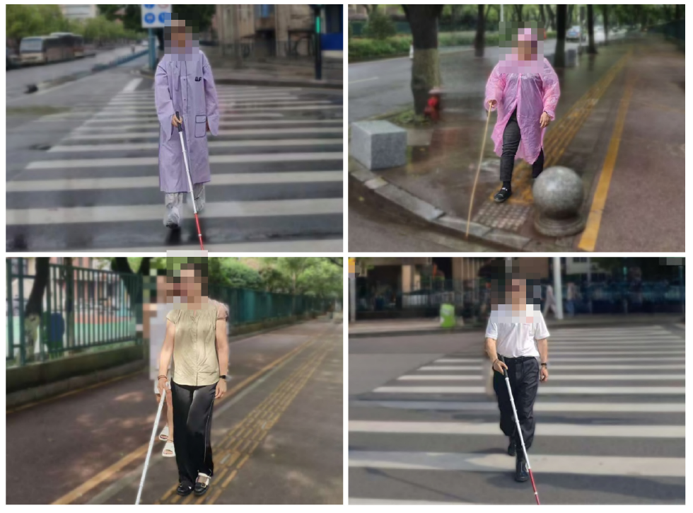
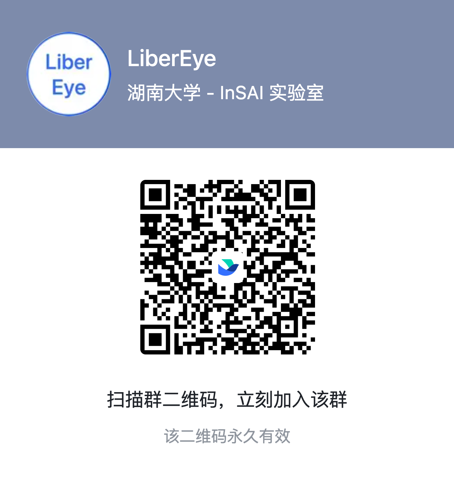

# LiberEye

**[Project Page Preview](https://insailab.org/workspace/preview/61b519ba-d7f2-43ef-9a66-30f347680441)**

LiberEye coordinates speech and wrist haptics for assistive navigation. A phone relays camera or glasses frames to a perception backend, then delivers the speech and Bluetooth wrist cues selected by Event-Priority Multimodal Coordination (EPMC).

The implementation follows Algorithm 1, equations (2) and (3), and Table 1 of *LiberEye: Event-Priority Coordination of Speech and Wrist Haptics for Assistive Navigation*.

<p align="center">
  
  
</p>

<p align="center">
  
  <br>
  Supervised outdoor sessions with four blind participants using white canes. Faces are obscured.
</p>

## Components

- [Backend](backend/README.md): perception, EPMC, authenticated HTTP API and deployment configuration.
- [iOS app](ios/README.md): phone camera, cloud relay, wrist control and optional licensed glasses integration.
- [Wrist firmware](firmware/libereye_wrist/README.md): nRF52840 and DRV2605L reference implementation, wiring and flashing instructions.

## Quick start

Use Python 3.11 or 3.12:

```bash
cd backend
python3.11 -m venv .venv
source .venv/bin/activate
python -m pip install -c constraints.txt '.[dev,hardware]'
python scripts/configure_cloud.py
python scripts/run_cloud.py
```

The server listens on `127.0.0.1:8080`. The configuration script creates a private `.env` with an API token. See the [backend guide](backend/README.md) for model and OCR setup, and the [deployment guide](backend/docs/cloud-deployment.md) for server, domain and app settings.

## Documentation

- [Algorithm and paper correspondence](docs/algorithm.md)
- [API and wrist protocol](docs/api.md)
- [Development, testing and source packaging](docs/development.md)

## Citation and licensing

See [CITATION.cff](CITATION.cff) for citation metadata and [third-party notices](THIRD_PARTY_NOTICES.md) for dependency terms. No redistribution license for the project source has been specified.

```bibtex
@unpublished{li2026libereye,
  author = {Li, Shicheng and Zhang, Jiuhan and Yang, Fengjiao and Zhang, Jiaming},
  title = {{LiberEye}: Event-Priority Coordination of Speech and Wrist Haptics for Assistive Navigation},
  year = {2026},
  note = {Under submission to ICASSP 2027}
}
```

[BibTeX](CITATION.bib) · [Citation metadata](CITATION.cff)

## Discussion

<p align="center">
  <a href="https://applink.feishu.cn/client/chat/chatter/add_by_link?link_token=fb8ice2e-8db6-446f-a96a-bf589ecb59dc&amp;qr_code=true">
    
  </a>
</p>

[Join the Feishu group](https://applink.feishu.cn/client/chat/chatter/add_by_link?link_token=fb8ice2e-8db6-446f-a96a-bf589ecb59dc&qr_code=true)
